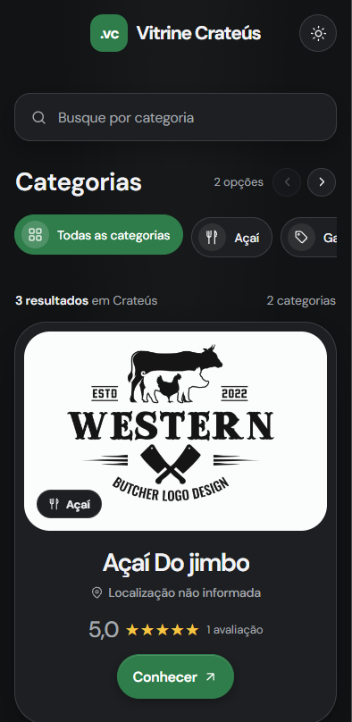
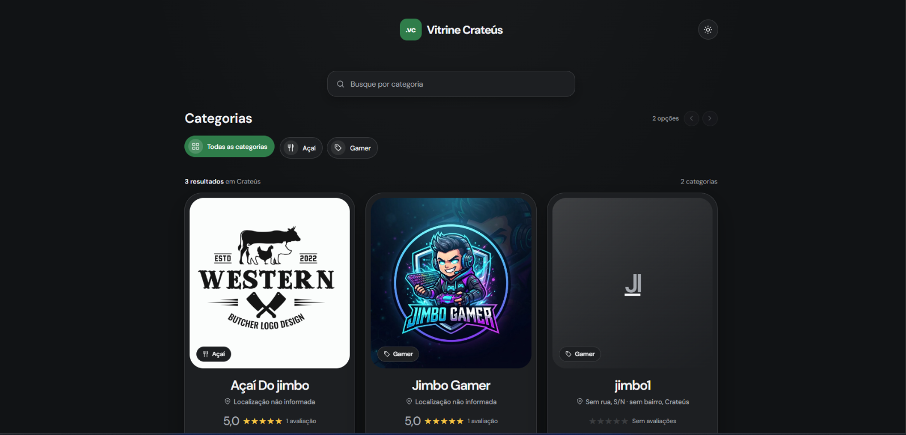
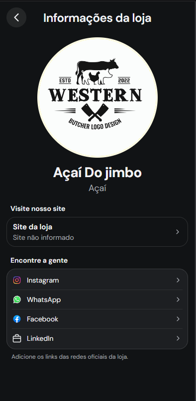
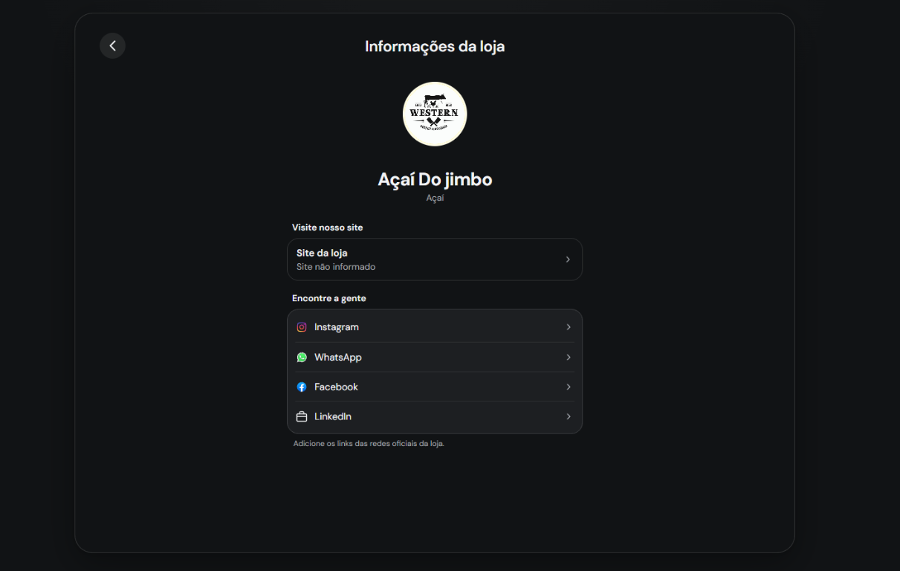
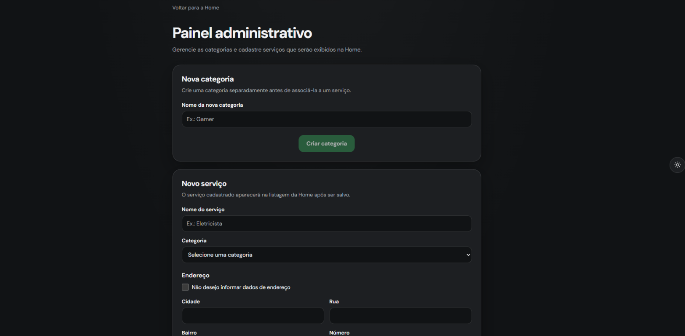

# Vitrine Crateús

> Um catálogo responsivo para descobrir empresas e serviços de Crateús, CE.

Explore os serviços por categoria, consulte as informações de cada negócio e acesse seus canais de contato. A interface funciona em celulares e desktops e oferece tema claro e noturno.

## ✨ O que o projeto oferece

- **Categorias dinâmicas:** carrega as categorias da API e mostra apenas aquelas relacionadas a serviços cadastrados.
- **Busca e filtros:** encontre categorias digitando seu nome ou selecionando-as nos filtros.
- **Navegação por categorias:** use toque, arraste com o mouse ou os botões de navegação do carrossel.
- **Resultados progressivos:** a página mostra 24 empresas por vez e permite carregar mais resultados.
- **Detalhes da loja:** os cards abrem as informações do serviço selecionado, com categoria, logo, endereço e links de contato.
- **Classificação:** os cards e a página do serviço exibem média e quantidade de notas; usuários autenticados podem registrar ou atualizar uma nota de 1 a 5.
- **Conta de usuário:** cadastro e login permitem acessar o fluxo de classificação; o token da sessão fica no `sessionStorage`.
- **Tema claro e noturno:** alterne pelo botão no cabeçalho; a preferência fica salva no navegador.
- **Painel administrativo:** a rota `/admin` separa o cadastro de categorias do cadastro de serviços.
- **Upload de logos:** aceita imagens PNG, JPG e SVG de até 5 MB.
- **Layout responsivo:** catálogo, detalhes e painel se adaptam a celulares e telas maiores.
- **Acessibilidade básica:** controles possuem rótulos acessíveis e estados de foco visíveis.

## 🖼️ Capturas de tela

As imagens abaixo mostram o catálogo, os detalhes de uma loja e o painel administrativo em telas móveis e desktop.

| Home — celular | Home — desktop |
| --- | --- |
|  |  |

| Detalhes da loja — celular | Detalhes da loja — desktop |
| --- | --- |
|  |  |

### Painel administrativo



## 🧰 Tecnologias

| Tecnologia | Uso |
| --- | --- |
| React 18 | Componentes e estado da interface |
| Vite 6 | Desenvolvimento local e build |
| Axios | Comunicação com a API REST |
| styled-components | Estilos isolados por componente e tokens globais |
| JavaScript (ES modules) | Dados e lógica da aplicação |

## 🚀 Comece a usar

### Pré-requisitos

- Node.js 18 ou superior
- npm

### Instalação

```bash
npm install
```

### Desenvolvimento

```bash
npm run dev
```

O Vite mostra no terminal o endereço local para abrir no navegador.

### API de serviços

Crie um arquivo `.env` na raiz usando `.env.example` como referência:

```env
VITE_API_BASE_URL=http://localhost:3333
```

A tela inicial consulta `GET /servicos` para montar os resultados e `GET /categorias-de-servico` para listar somente categorias com serviços relacionados e filtrar os resultados. O hook `useServicos` controla os dados, o carregamento, os erros e a função `refetch`; o `CompanyGrid` apresenta os resultados e permite tentar novamente quando a chamada falha. Se não for possível carregar as categorias, a interface informa o erro e permite tentar novamente.

Ao abrir um card, a página de informações consulta `GET /servicos/:id` e exibe os dados do serviço correspondente, incluindo categoria, logo, endereço e links de contato.

### Cadastro, login e classificação

As telas `/cadastro` e `/login` usam `POST /users` e `POST /auth/login`. O cadastro envia `name`, `email`, `password` e `provider: false`; a senha precisa ter entre 8 e 72 bytes. O login guarda o token Bearer recebido em `sessionStorage`, e o cliente Axios o envia automaticamente no cabeçalho `Authorization` das requisições.

`GET /servicos` e `GET /servicos/:id` incluem `classificacao` com `media` e `quantidade`. O botão de classificação exibe esses dados e, quando há uma sessão, consulta `GET /servicos/:id/avaliacao` para mostrar a nota do usuário. O envio usa `PUT /servicos/:id/avaliacao` com `{ "nota": 5 }`; o backend cria ou atualiza a nota e retorna a classificação atualizada.

Sem uma sessão, a interface encaminha para `/login`; depois do login, retorna à página de origem. O acesso é limitado a notas inteiras de 1 a 5, uma por usuário e serviço. A tela não solicita nem envia comentários de texto, pois a API de classificação aceita somente uma nota.

O cadastro usa `GET /categorias-de-servico` para preencher as categorias e envia `POST /servicos` como `multipart/form-data`. O campo `categoria` recebe o ID de uma categoria existente; os dados de contato são enviados individualmente (`site`, `instagram`, `facebook`, `whatsapp`, `linkedin`). Cidade, rua, bairro, número e contatos opcionais vazios são omitidos.

A logo pode ser um arquivo PNG, JPG ou SVG de até 5 MB e é enviada no campo `logo`. O envio usa `FormData` sem definir `Content-Type` manualmente, para que o navegador inclua o `boundary`. A API retorna caminhos como `/uploads/servicos/<arquivo>`; o front-end os converte em URL completa usando a URL base da API para exibir a imagem. Em produção, configure `storage/uploads` como volume persistente ou use armazenamento de objetos.

O formulário permite omitir o endereço e exibe erros de validação retornados pela API sem indicar sucesso quando o cadastro falha.

Para informar uma categoria nova, o painel verifica se o nome já existe e envia `POST /categorias-de-servico` com `{ "nome": "..." }`. Após a atualização da lista, selecione essa categoria; o serviço é cadastrado com o ID em `categoria`.

O painel de gerenciamento fica disponível em `/admin`, com formulários separados para criar categorias e serviços. A rota ainda não possui autenticação; para restringir cadastros a administradores, a API também precisa validar a identidade e as permissões do usuário.

Se o navegador bloquear a chamada por CORS quando o front-end e a API usam portas diferentes, habilite CORS na API para permitir a origem do Vite (por padrão, `http://localhost:5173`). Em uma API Express, por exemplo, configure o middleware CORS no servidor antes das rotas:

```js
app.use(cors({ origin: 'http://localhost:5173' }));
```

Se necessário, instale e importe o pacote `cors` no projeto da API. Em desenvolvimento, também é possível configurar um proxy no `vite.config.js`. CORS deve ser configurado no servidor da API ou no proxy de desenvolvimento, não com cabeçalhos adicionados pelo front-end.

### Build de produção

```bash
npm run build
```

### Pré-visualizar o build

```bash
npm run preview
```

### Publicar no Netlify

O arquivo `public/_redirects` encaminha rotas da aplicação, como `/paginaLoja?companyId=1`, para o `index.html`. Assim, o React consegue abrir a loja selecionada mesmo ao acessar ou atualizar essa URL diretamente. Configure `VITE_API_BASE_URL` no ambiente de build para apontar para a API publicada.

## 🗂️ Estrutura do projeto

```text
src/
├── App.jsx
├── main.jsx
├── assets/
│   ├── icons/                 # Cada ícone SVG em sua própria pasta
│   └── logos/                 # Imagens locais usadas nos cards
├── components/
│   ├── CategoryCarousel/      # Carrossel e estilos das categorias
│   ├── CompanyCard/           # Card individual e estilos
│   ├── CompanyGrid/           # Grade e estado vazio
│   ├── FormularioCategoria/   # Cadastro independente de categorias
│   ├── FormularioServico/     # Cadastro de serviços e upload de logo
│   ├── Icon/                  # Seletor central de ícones
│   ├── Modal/                 # Diálogos acessíveis
│   └── ThemeToggle/           # Botão para alternar o tema
├── services/
│   ├── api.js                 # Cliente Axios e URL base
│   └── servicosService.js     # Requisições de serviços e categorias
├── hooks/
│   ├── useCategoriasDeServico/ # Categorias, carregamento, erro e refetch
│   ├── useServicos/           # Serviços, carregamento, erro e refetch
│   └── useTheme/              # Estado e persistência do tema
├── data/
│   ├── companies.js           # Dados de fallback da loja
│   └── paginaLoja.js          # Conteúdo de fallback da página de loja
├── pages/
│   ├── Admin/                 # Painel de criação de categorias e serviços
│   ├── Home/                  # Catálogo, busca e filtros
│   └── PaginaLoja/            # Detalhes do serviço selecionado
├── styles/
│   └── GlobalStyle.js         # Reset, fontes e variáveis de tema
└── utils/
    └── categoryIcons.js       # Relação entre categoria e ícone

docs/
└── screenshots/               # Capturas de telas mobile e desktop
```

Os componentes visuais ficam em pastas próprias. Quando há estilos específicos, o arquivo `.styles.js` acompanha o componente `.jsx`. A tela inicial adapta os campos de `/servicos` (`nome`, `categoriaDeServico`, `rua`, `numerodoendereco`, `bairro`, `cidade` e `logo`) ao formato usado pelos cards.

## 🏢 Dados das empresas

A tela inicial consome os serviços de `GET /servicos`. A API retorna registros neste formato:

```js
{
  id: 2,
  nome: 'Eletricista',
  categoria: 2,
  cidade: 'Crateús',
  bairro: 'Centro',
  numerodoendereco: '123',
  logo: '/uploads/servicos/logo.jpg',
  categoriaDeServico: { id: 2, nome: 'Açaí' },
  classificacao: { media: 4.7, quantidade: 12 }
}
```

Os dados da API são adaptados ao modelo consumido por `CompanyCard`. Logos retornadas em caminhos como `/uploads/servicos/<arquivo>` são resolvidas contra a URL base da API. Uma imagem ausente ou indisponível exibe as iniciais do serviço.

## 🧭 Organização da interface

- **`Home`** prepara a busca, as categorias selecionadas e a quantidade de resultados visíveis.
- **`CategoryCarousel`** apresenta os ícones definidos em `categoryIcons.js` e notifica a página quando a seleção muda.
- **`CompanyGrid`** recebe a lista filtrada e monta um `CompanyCard` para cada empresa.
- **`CompanyCard`** direciona a imagem e o botão para `/paginaLoja?companyId=<id>` usando o ID da API; a página consulta `GET /servicos/:id`.
- **`Admin`** apresenta formulários separados para criar categorias e serviços em `/admin`.
- **`Auth`** oferece cadastro em `/cadastro` e login em `/login` para o fluxo de classificação.
- **`FormularioCategoria`** envia novas categorias para `POST /categorias-de-servico`.
- **`FormularioServico`** envia os dados do serviço e a logo via `FormData` para `POST /servicos`.
- **`useTheme`** aplica o tema no documento e guarda a escolha com a chave `vitrine-theme` no `localStorage`.
- **`GlobalStyle`** define as cores base e as variáveis para os modos claro e noturno.

## 🎨 Estilos e temas

Os estilos dos componentes são escritos com `styled-components`. As cores compartilhadas ficam em `src/styles/GlobalStyle.js` como variáveis CSS, incluindo superfícies, textos, bordas, sombras e o verde de destaque. Isso mantém os dois temas coerentes sem duplicar os estilos de cada componente.

## 📝 Scripts disponíveis

| Comando | Ação |
| --- | --- |
| `npm run dev` | Inicia o servidor de desenvolvimento |
| `npm run build` | Gera a versão de produção em `dist/` |
| `npm run preview` | Serve localmente o build gerado |

---

Feito para deixar os negócios de Crateús mais fáceis de encontrar. 🌿
